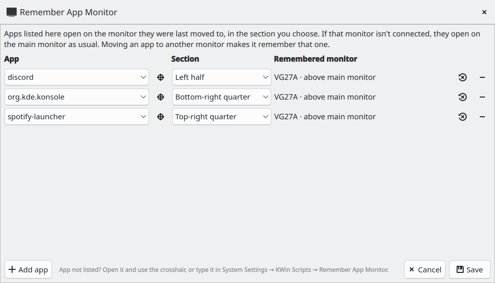
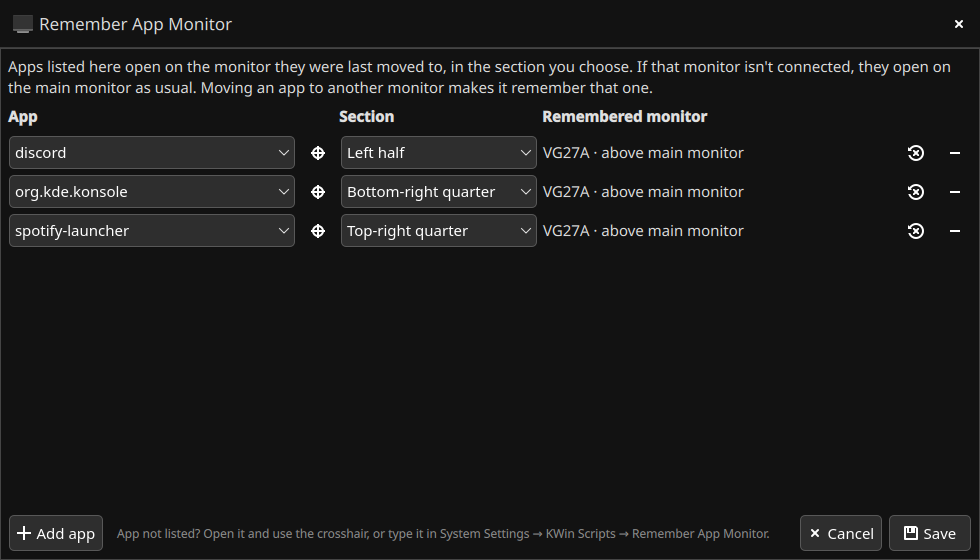

# Remember App Monitor

A KWin script for KDE Plasma 6 that opens chosen apps on the monitor you last moved them to, in a section of that monitor you pick (left half, top-right quarter, center third, maximized, ...).

| Light | Dark |
| --- | --- |
|  |  |

- Monitors are identified by **manufacturer, model and serial number**, so changing ports doesn't matter, and two identical monitors at different desks are treated as different monitors. Monitors that report no serial number fall back to manufacturer and model.
- If the remembered monitor isn't connected, the app opens on the **main monitor**, wherever and however it places itself.
- Moving an app to another monitor makes it remember that monitor. Moves caused by plugging or unplugging monitors are ignored.
- Apps that restore their own maximized state on launch (e.g. Discord) are put back in their section for the first few seconds; after that you can maximize them freely.

## Settings

Press **Meta+Ctrl+M**, or open **Remember App Monitor** from the app launcher (installed by `make install`). For each app:

- **App:** choose it from the list of open windows and installed apps, or click the crosshair button and then click the app's window.
- **Section:** where on the monitor it opens.
- **Remembered monitor:** the monitor it opens on. It's remembered when you move the app to another monitor, or, if none is remembered yet, when the app is closed. It's described by where it sits ("above main monitor") or, when it isn't connected, when it was last seen. Two remembered monitors of the same model also show the end of their serial number; hover for the full details. The button next to it forgets the monitor.

KWin doesn't deliver keyboard input to windows created by KWin scripts (Plasma 6.7), so the settings window is mouse-only. Apps that can't be picked there can be typed in System Settings → Window Management → KWin Scripts → Remember App Monitor (settings button), one `window class = section` per line; the settings window's list wins when an app is in both.

The shortcut can be changed in System Settings → Keyboard → Shortcuts → KWin → "Remember App Monitor: Open Settings".

Data is stored in `~/.config/kde.org/kwin.conf` under `[RememberAppMonitor]`: `_apps` holds the app list, `_seen` when each monitor was last connected, and every other key is an app id mapped to its remembered monitor (`manufacturer|model|serial`).

## Install

```sh
make install     # installs/upgrades the package, adds the launcher entry, enables and reloads the script
make uninstall
```

Or build a package with `make package` and install `dist/*.kwinscript` through System Settings → Window Management → KWin Scripts → Install from File.

> **Note:** KWin caches the files in a script's folder for the whole session. When an upgrade **adds new files**, the new version won't load correctly until you log out and back in.

## Development

```
package/                 the KWin script (KPackage)
  metadata.json
  contents/code/logic.js       placement logic, pure JavaScript (unit tested)
  contents/ui/main.qml         wires the logic to KWin: window events, saving monitors, shortcut
  contents/ui/SettingsWindow.qml
  contents/ui/config.ui        System Settings page (points to the settings window)
tests/                   unit tests for logic.js and the store uploader
extras/                  app launcher entry for the settings window
scripts/pling_upload.py  KDE Store uploader used by the release workflow
release-please-config.json, .release-please-manifest.json   automatic versioning
```

Run the tests with `make test`. They need Python 3 and PySide6 (`pip install PySide6-Essentials`, or your distribution's `python3-pyside6`). They run `logic.js` in Qt's QJSEngine, the same JavaScript engine KWin uses.

Debugging: `console.warn()` output and QML load errors ("Component failed to load") appear in `journalctl -b`.

## Releases

Versions are bumped automatically from commit messages ([Conventional Commits](https://www.conventionalcommits.org)) by [release-please](https://github.com/googleapis/release-please-action):

| Commit message | Version bump |
| --- | --- |
| `fix: keep Discord unmaximized` | patch, 1.0.0 → 1.0.1 |
| `feat: add a bottom-third section` | minor, 1.0.0 → 1.1.0 |
| `feat!: ...` or a `BREAKING CHANGE:` footer | major, 1.0.0 → 2.0.0 |
| `docs:`, `test:`, `ci:`, `chore:`, `refactor:` | none |

How a release goes (`.github/workflows/release.yml`):

1. Every push to `main` updates an open **"chore(main): release x.y.z"** pull request with the next version (in `package/metadata.json`) and `CHANGELOG.md`.
2. **Merging that pull request** tags `vx.y.z` and creates a GitHub release. The workflow runs the tests, builds the `.kwinscript` and attaches it to the release.
3. The KDE Store upload then **waits for approval**. GitHub notifies the reviewers of the `kde-store` environment; nothing is sent until one of them clicks *Review deployments → Approve* on the workflow run.
4. Once approved, the package and the changelog entry are uploaded to the KDE Store listing.

`.github/workflows/ci.yml` runs the tests and builds the package on every push and pull request. Release pull requests are opened by GitHub Actions, and GitHub doesn't run CI on those, but the release workflow runs the tests again before building.

### KDE Store upload

KWin scripts are distributed through the [KDE Store](https://store.kde.org), which is what System Settings → KWin Scripts → **Get New...** and Discover browse. The store has no official upload API, so `scripts/pling_upload.py` (vendored from [kde-6-widget-starter](https://github.com/ruinivist/kde-6-widget-starter), MIT) logs in to the website with your account and uses the same requests as the product edit page. It **replaces all files** on the listing with the new package and adds the changelog entry. Because it imitates the website, a change to the store's site can break it; the release on GitHub is unaffected and the package can still be uploaded by hand.

One-time setup:

1. Create the listing by hand at store.kde.org: category **KWin Scripts** (Linux/Unix Desktops → Window Managers → KWin → KWin Scripts), marked for **Plasma 6** (listings tagged for Plasma 5 don't show up in Plasma 6's "Get New..."). The number in its URL (`store.kde.org/p/<number>`) is the project id.
2. In the GitHub repository settings:
   - **Actions → General → Workflow permissions:** enable *Allow GitHub Actions to create and approve pull requests* (needed for the release pull request).
   - **Environments → New environment** `kde-store`: add yourself under *Required reviewers*, and add the **environment secrets** `PLING_USERNAME` (store login email) and `PLING_PASSWORD`. As environment secrets, they're only readable by jobs that were approved.
   - **Secrets and variables → Actions → Variables:** add `KDE_STORE_PROJECT_ID` with the project id.
3. Run **Actions → KDE Store login check → Run workflow** (and approve it) to check the login and project id without changing anything.

Required reviewers on environments are free for public repositories; private repositories need a paid GitHub plan.

## License

MIT
